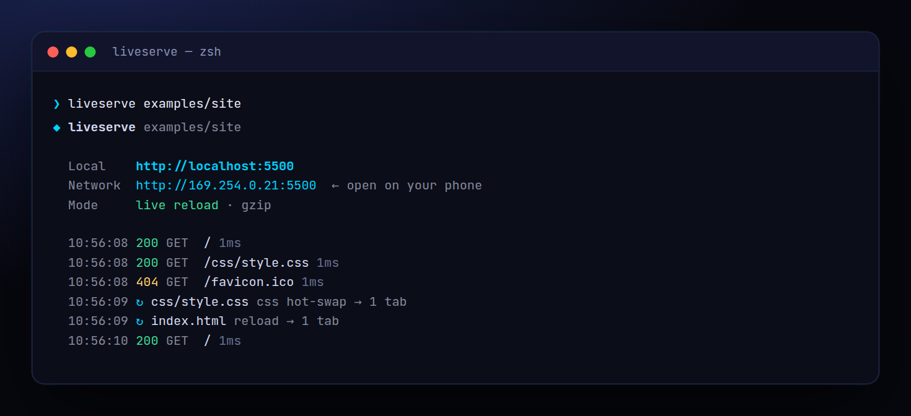

<!-- ═════════════ HEADER ═════════════ -->
<p align="center">
  
</p>

<p align="center">
  
</p>

<p align="center">
  <a href="https://github.com/krishyaa06/prism-live-serve/actions/workflows/ci.yml"></a>
  
  
  <a href="LICENSE"></a>
</p>

<p align="center">
  
</p>


## ⚡ Overview

**Prism Live Serve** (`liveserve`) is the tiny dev server for plain HTML / CSS / JS projects, prototypes and build outputs. Point it at a folder and every save reloads the browser; CSS edits are hot-swapped in place so you keep your scroll and state. It prints a LAN URL so you can test on your phone, picks the next free port if 5500 is busy, supports SPA routing (`--spa`), and does all of it with Node's built-in `http` and `fs.watch` — no dependencies, no config.

## ✨ Features

- **Live reload** over Server-Sent Events, injected automatically into every HTML page
- **CSS hot-swap**: stylesheet changes apply without reloading the page
- **LAN URL** printed for phone / tablet testing; auto-picks the next free port
- `--spa` fallback to `index.html` for client-side routers; clean URLs (`/about` → `about.html`)
- Directory listings, custom `404.html`, gzip, ETag / 304, range requests (video seeking)
- `--cors`, `--open`, `--quiet`; path-traversal safe. Zero dependencies

## 🚀 Quick Start

```bash
# run without installing
npx github:krishyaa06/prism-live-serve 

# or install globally
npm install -g github:krishyaa06/prism-live-serve
liveserve dist --spa --open
```

Requires Node.js 18.17+. No dependencies.

## 🛠️ Usage

```text
liveserve [dir] [options]

  -p, --port <n>       port (default 5500, next free one if busy)
  -H, --host <addr>    bind address (default 0.0.0.0)
  -o, --open           open the browser
      --spa            serve index.html for unknown routes
      --cors           Access-Control-Allow-Origin: *
      --no-live        disable live reload
      --no-gzip        disable compression
  -q, --quiet          don't log requests
```

### Examples

```bash
liveserve                 # current folder on :5500
liveserve dist --spa -o   # preview a React/Vite build with client routing
liveserve -p 8080 --cors  # serve JSON fixtures to another app
```

Use it as a library too:

```js
const { createServer, watch } = require("prism-live-serve");
const server = createServer("public", { spa: true });
watch("public", (files) => server.reload(files));
server.listen(3000);
```

## 📁 Project Structure

```text
prism-live-serve/
├── assets/
│   ├── logo.png
│   └── logo.svg
├── bin/
│   └── liveserve.js   # CLI entry
├── examples/
│   └── site/   # demo page
│       ├── css/
│       │   └── style.css
│       └── index.html
├── src/
│   ├── index.js   # server, live-reload client, watcher
│   └── ui.js   # colours, tables
├── test/
│   └── liveserve.test.js
├── .gitignore
├── LICENSE
├── README.md
└── package.json
```

## 🧪 Tests

```bash
npm test
```

Tests use the built-in `node:test` runner, so there is nothing to install. CI runs them on Node 20 and 22.

## 🤝 Contributing

1. Fork the repo and create a branch: `git checkout -b feature/my-idea`
2. Make your change and add a test in `test/`
3. Run `npm test` and open a Pull Request

## 🔷 Part of Prism Protocol

Prism Live Serve is one of the open-source tools built by [Prism Protocol](https://dc.gg/prismprotocol), a tech community where young builders learn, ship and compete together.

## 👤 Author

<table>
  <tr>
    <td align="center">
      <a href="https://github.com/krishyaa06"><br><b>Soumya Bhandare</b></a><br>
      <sub>Founder @ Prism Protocol</sub>
    </td>
    <td>
      <a href="https://dc.gg/prismprotocol"></a><br>
      <a href="https://instagram.com/prism_protocol_"></a><br>
      <a href="https://x.com/krishyaa06"></a>
    </td>
  </tr>
</table>

## 📄 License

Released under the [MIT License](LICENSE).

<p align="center">
  <b>If you like this project, consider giving it a ⭐</b><br>
  <sub>"Build. Create. Compete." · Made with ⚡ by Prism Protocol</sub>
</p>


